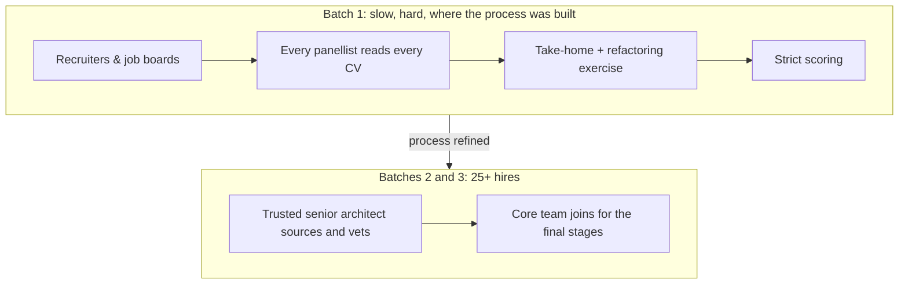

## [draft]

Whenever I interview for an leadership role and the subject of hiring comes up, or start hiring, someone asks me how I hire. I've answered that out loud many times, usually with a rough sketch. This series writes it down properly: the whole method, from planning a hire to checking a year later whether it worked.

The method started at Policy Expert, where I was Head of Technology from 2013 to 2019. That's where I built it, broke it and fixed it. I've hired this way ever since, because it works.

Here's what it produced there. We grew engineering from 6 to 40 people across 7 teams. Developer retention ran at 3× the London average. Hiring offshore and outside London, and no longer paying recruiter fees of around 30%, saved roughly $400K a year. The saving wasn't the point, though. The team kept delivering while onboarding much higher numbers.

The series has three parts. Each one pairs a story with something you can take away and use.



This part covers everything before the first interview: planning, what you're hiring for, the job description, reading CVs and the first call.

## Plan three to six months out

Hiring is slow. Sourcing takes time, vetting takes time, good people have notice periods, and onboarding takes longer than anyone budgets for. Add it up and a hire you need today is a hire you should have started a quarter ago.

So I plan 3–6 months out. If the need is real now, I bridge it with a strong contractor, with clear objectives bounded to that window. The bounds matter. Without them a contractor drifts into long-term work and you've built a dependency instead of a bridge. With them, the contractor delivers the urgent work and gets the ground ready, so the permanent hires walk into something they can pick up.

The other thing I do before sourcing starts is write the rubric: the competencies I'll score every candidate against, and what "meets" looks like for this level. Part 2 covers it in detail. It comes first because everything in this post, the job description and the CV screen included, is built from it.

## Culture add, as a piano scale

I don't hire more of the same. I hire for culture add, and the way I explain it is a piano scale.

Say the team covers the notes A, B, D and F. Another A doesn't make the music any richer. What I'm looking for is C, E or G: notes that complement the team, inside the same cultural octave. They share the values. They bring something the team doesn't have yet.

_Filled: notes the team already has. Dashed: the gaps worth hiring for._

Skills work the same way. Nobody knows all of Python. A team where everyone is strong in the same corner of it has blind spots in the same places. I'd rather hire depth that complements what's already there.

## The job description

Most job descriptions read like a shopping list of frameworks. The good candidates have options, so the job description has to sell before it filters. Mine are built in this order.

**Job description checklist**

- [ ] **Company and values first.** Why this company exists and what it cares about, before anything about the candidate.
- [ ] **Who they'll work with.** The team, its size, and the people they'll sit next to.
- [ ] **The impact.** What will be different because this person joined.
- [ ] **The ideal candidate.** Described in principles and behaviours, taken from the rubric, not as a list of frameworks.
- [ ] **The interview process.** Every stage, so the candidate knows what's coming.
- [ ] **The salary range.** Always.
- [ ] **No exclusionary wording.** Read it for anything that quietly tells good people it isn't for them: degree requirements the role doesn't need, years-of-experience gates, gendered or "rockstar" language.

## Reading CVs for principles, not keywords

A keyword match tells you someone has used a word. I read a CV for evidence of what they did and why it mattered.

The CV is itself a communication sample. How someone explains their own work to a reader they've never met tells me something real. If there's a GitHub or a blog, I follow the link, but that's a bonus and never a requirement; plenty of good engineers have neither. Where the process allows, names and schools come off before the panel reads.

And I don't exclude on background. Some of the best engineers I've hired were self-taught, had a Geography degree, or came straight from school.

Every application gets one short question:

> In 3–4 sentences, a piece of code or design decision you're proud of, and why.

It's small enough that nobody is put off, and it shows whether someone can explain a decision as well as make one.

**CV screening criteria**

I score each CV, and the answer to that question, against three criteria taken from the rubric:

| Criterion            | From the rubric               | What I look for                                                                 |
| -------------------- | ----------------------------- | ------------------------------------------------------------------------------- |
| Evidence of judgment | Technical judgment            | They say why, not just what: a choice they made, and what it achieved           |
| Clear communication  | Communication & collaboration | A stranger can follow the CV and the answer without having to dig for the point |
| Curiosity            | Curiosity & growth            | Something learned outside their immediate role, and used                        |

A CV that shows all three goes forward. Keywords don't appear in the table on purpose.

## First contact

The first call, phone or video, is mostly me selling. The company, the work, the values, the team they'd join. I'm not trying to catch anyone out at this stage. I want the right people to want to go through the rest of the process, because the next stages ask real work of them.

## The story: growing a team in batches

At Policy Expert the growth came in batches, and each batch changed how we hired.

The first batch was slow and hard. We used recruiters and job boards. Every panellist read every CV independently, and we scored strictly. That batch is where the take-home, the refactoring exercise and the scoring were refined. [[GAP: how many hires were in batch 1, and roughly how long did it take?]] [[GAP: one concrete moment from batch 1 that shows why it was slow or hard]]

The next two batches were more than 25 hires. Doing it the batch 1 way, at that size, wasn't going to work.

So I proposed a talent strategy. [[GAP: who did you pitch it to (role, not name), and what convinced them?]] I contracted a senior architect I knew and trusted, and taught them what we needed and how we hired. They sourced and vetted candidates, and the core team joined late, for the final stages. [[GAP: did the architect source offshore and outside London, i.e. is this where the hiring-cost saving came from?]]

It worked because of trust. We had shared history, so I knew how they judged people. And the person judging the craft was an engineer, not a recruiter matching keywords.

## What I'd do differently today

**Call it culture add.** Back then our final stage was called "team fit". The name matters, because a stage called fit gets used to find more of the same. Today that stage is about culture add, and the panel goes in knowing which notes the team is missing.

**Make the trust transferable.** The architect worked because I trusted them, and that trust was personal. It wouldn't have transferred to someone else. Today I'd back it with tracking: pass rates at each stage, where hires came from and how they performed afterwards, so the next person running the process can see it working instead of taking my word for it. Part 3 covers the tracking.

## Next

Part 2, _Hire engineers, not coders_, covers vetting and the decision: the take-home and how I extend it face to face, the levelled rubric, where AI fits, and the story behind the unanimous vote.
