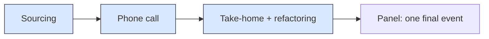

Part 2 of [How I Hire](). Sourcing: finding the right people and getting them to want the job.



## The job description has to sell

Most job descriptions read like a shopping list of frameworks. The good candidates have options, so the job description has to sell before it filters. Mine are built in this order.

**Job description checklist**

- [ ] **Company and values first.** Why this company exists and what it cares about, before anything about the candidate.
- [ ] **Who they'll work with.** The team, its size, and the people they'll sit next to.
- [ ] **The impact.** What will be different because this person joined.
- [ ] **The ideal candidate.** Described in principles and behaviours, taken from the rubric, not as a list of frameworks.
- [ ] **The interview process.** Every stage, so the candidate knows what's coming.
- [ ] **The salary range.** Always.
- [ ] **No exclusionary wording.** Read it for anything that quietly tells good people it isn't for them: degree requirements the role doesn't need, years-of-experience gates, gendered or "rockstar" language.

## Reading CVs for principles, not keywords

A keyword match tells you someone has used a word. I read a CV for evidence of what they did and why it mattered.

The CV is itself a communication sample. How someone explains their own work to a reader they've never met tells me something real. If there's a GitHub or a blog, I follow the link, but that's a bonus and never a requirement; plenty of good engineers have neither. Where the process allows, names and schools come off before the panel reads.

And I don't exclude on background. Some of the best engineers I've hired were self-taught, had a Geography degree, or came straight from school.

Every application gets one short question:

> In 3–4 sentences, a piece of code or design decision you're proud of, and why.

It's small enough that nobody is put off, and it shows whether someone can explain a decision as well as make one.

**CV screening criteria**

I score each CV, and the answer to that question, against three criteria taken from the rubric:

| Criterion | From the rubric | What I look for |
| --- | --- | --- |
| Evidence of judgment | Technical judgment | They say why, not just what: a choice they made, and what it achieved |
| Clear communication | Communication & collaboration | A stranger can follow the CV and the answer without digging for the point |
| Curiosity | Curiosity & growth | Something learned outside their immediate role, and used |

A CV that shows all three goes forward. Keywords don't appear in the table on purpose.

## First contact

The first call, phone or video, is mostly me selling. The company, the work, the values, the team they'd join. I'm not trying to catch anyone out at this stage. I want the right people to want to go through the rest of the process, because the next stages ask real work of them.

## The story: handing over the pipeline

Policy Expert's first hires came through recruiters and job boards, at around 30% of a salary each, and the team ran every stage itself. That's the 20–30% of our time from [Plan]().

The later batches were more than 25 hires. Doing it that way at that size wasn't going to work. So I brought in an old friend, a senior architect I knew and trusted, and taught them what we needed and how we hired. They ran the pipeline: sourcing, the phone call, the take-home and the refactoring exercise. The panel came in at the end, as a single event. Over the same years, much of our hiring moved offshore and outside London.

_Blue: run by the architect. The panel joined for the final stage._

It worked because of trust. We had shared history, so I knew how they judged people. And the person judging the craft was an engineer, not a recruiter matching keywords. It also gave the team its time back, and they spent it on the platform and on onboarding properly. That's the story in [Onboard]().

## The story: when there's no money to sell

Many of the startups I've worked with were low on funding, so pay couldn't do the selling. We hired graduates and part-timers on small salaries or equity. Sourcing there was selling the idea and the opportunity, with training, coaching and mentoring as the hook, and then matching people's curiosity to what we needed.

The job description checklist still held. It just leaned harder on impact and on what they'd learn.

## What I'd do differently today

**Call it culture add.** Back then our final stage was called "team fit". The name matters, because a stage called fit gets used to find more of the same. Today that stage is about culture add, and the panel goes in knowing which notes the team is missing.

**Make the trust transferable.** The pipeline handover worked because I trusted the architect, and that trust was personal. It wouldn't have transferred to someone else. Today I'd back it with tracking: pass rates at each stage, where hires came from and how they performed afterwards, so the next person running the process can see it working instead of taking my word for it. [Reflect]() covers the tracking.

Next: [Vet](), hiring engineers, not coders.
