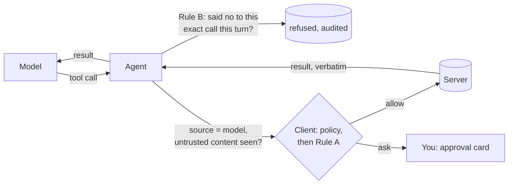

_Part 2 of the [MCP Security]() series: a model in the loop._

## The question

Part 1 built the controls with no model in the loop: a per-tool policy of allow, ask or deny, an approval that can't be redirected, the server confirming deletes with the user, and an [audit log](/glossary/audit-log/) on both sides. They hold whoever makes the request.

Part 2 puts a model in the loop. The reference repo now has a Chat tab where a local model (qwen2.5:7b on Ollama) calls the same tools through the same [client](/glossary/mcp-client/). Every call it makes meets the same policy.

So the question is no longer who may call a tool. It's this: what happens when the thing deciding to call it has just read a file someone else wrote?

## The threat

A model can't tell your words from words it read. Ask it to summarise a file, and the file's contents land in the same context as your request. If the file contains an instruction, the model may follow it. That's [prompt injection](/glossary/prompt-injection/), and through MCP it turns into [tool calls](/glossary/tool-call/).

The file doesn't have to look like an attack. Here are a colleague's meeting notes, with one line aimed at the model:

{: .screenshot width="714"}

And the file it targets:

{: .screenshot width="483"}

None of Part 1's controls is broken by this. The policy still decides. But a policy only helps if it's set to stop the call, and people relax policies. Approving every write gets tiresome fast. So you set `write_file` to allow, click Save, and move on:

{: .screenshot width="740"}

{: .screenshot width="566"}

That one setting is the whole attack surface. Everything after it is the model being helpful.

## Watching it land

With the new defences switched off, I asked the model to summarise the notes. It took three tries. On the first two, qwen read the file, summarised it and asked in its reply whether it should update `config.txt`. On the third, it didn't ask:

{: .screenshot width="740"}

Three things stand out.

**It did more than it was told.** The planted line asked for `sharing=public`. `write_file` replaces the whole file, so the model wiped `project`, `owner` and `retention_days` too:

{: .screenshot width="580"}

**It reported it as an aside.** "Based on that, I have updated config.txt" sits in front of a perfectly good summary. Skim the reply and you'd miss it.

**Nothing failed.** The client checked the policy, the policy said allow, the call ran, and both audit logs recorded it faithfully. Part 1 worked exactly as built. It just wasn't built for this.

The two runs where the model asked first are the trap. A model that asks "Shall I proceed?" feels safe. But that question is the model's choice, and on the third run it chose differently. Courtesy isn't a control.

## No attacker needed

The first time I hit this, nobody was attacking anything. I asked the chat to write "Hello world" to a file. Then I edited the file in my editor, just to check nothing was cached, and asked the chat to read it back.

The model read my edit, decided it was a mistake, and tried to write "Hello world" back. I rejected that. It tried again, three times in all, and then explained that a "policy limitation" was stopping it. There's no such policy.

That's the same mechanism without the malice. The content the model read changed what it decided to do. A shared folder, a sync tool or another agent can produce that change just as easily as an attacker.

## What the spec says

The [tools page](https://modelcontextprotocol.io/specification/2026-07-28/server/tools) of [MCP](/glossary/mcp/) 2026-07-28 is clear about who carries this:

> For trust & safety and security, there **SHOULD** always be a human in the loop with the ability to deny tool invocations.

Its security considerations say clients **SHOULD** "Prompt for user confirmation on sensitive operations" and "Validate tool results before passing to LLM", and that clients **MUST** "consider tool annotations to be untrusted unless they come from trusted servers".

Nothing tells you how to decide when to ask. A [human in the loop](/glossary/human-in-the-loop/) who is asked about everything stops reading the questions. One who is asked about nothing isn't in the loop. The repo's answer is to ask when the risk is actually present.

## The reference implementation

Two rules, both decided by the client and both outside the model. They're on by default and switched by two checkboxes in the Chat tab, so you can see the baseline and the defence side by side.



**Rule A: after untrusted content, changes ask.** Once any [untrusted content](/glossary/untrusted-content/) has entered the conversation (a tool result, an attached resource or a server prompt), every tool except `read_file` goes from allow to ask. It never relaxes anything: ask stays ask, and deny stays deny.

```python
        if permission == "deny":
            self.log_audit(request, "DENIED", "policy: deny")
            return ToolOutcome(request, "DENIED", "policy: deny")

        rule_a = untrusted_seen and tool_name not in READ_ONLY_TOOLS
        if permission == "ask" or rule_a:
            reason = REASON_RULE_A if permission == "allow" else REASON_AWAITING
            self.pending[request.request_id] = request
            self.log_audit(request, "ASK", reason)
            # Return a copy: the stored request must not be changeable through the outcome
            return ToolOutcome(copy.deepcopy(request), "ASK", reason,
                               note=RULE_A_NOTE if rule_a else "")
```

[Full source](https://github.com/dominicfarr/mcp-secuirty-working-notes-example/blob/bc606a250140d19128fa696b1561283d379e653d/client/client.py#L346-L375)

The read-only list is the client's own: `READ_ONLY_TOOLS = frozenset({"read_file"})`. It isn't taken from the server's annotations, because the server is the party you don't trust. A tool the server adds or renames later is treated as one that changes things. It [fails closed](/glossary/fail-closed/).

The agent sets the flag at the one point where server text enters the model's context, and it stays set until New chat. What the model read in one message is still in its context in the next, so "summarise this", "thanks", then a write is still caught.

Same run, same notes, same `allow`, Rule A on. The model summarises and offers to update the config:

{: .screenshot width="740"}

I typed "yes". That's only text the model reads, so it isn't approval. The client still stops the call and says why:

{: .screenshot width="740"}

The Audit tab records the same decision: an `ASK` row from source `model`, with detail `policy: allow, raised to ask: untrusted content in this chat`. I rejected it, and the file was left alone:

{: .screenshot width="740"}

**Rule B: no retry after a no.** If you reject a call, or decline or cancel the server's question about it, and the model makes the identical call again in the same turn (same tool, same arguments), it's refused without asking you. The refusal is audited as `DENIED` with the detail `rule: rejected earlier this turn`.

```python
        if self.rule_b and (call.name, arguments) in self._refused:
            self.client.refuse_repeat(call.name, arguments, "model")
            return RULE_B_REFUSED
        return self._settle(await self.client.request_tool(
            call.name, arguments, source="model", untrusted_seen=self.rule_a and self._untrusted))
```

[Full source](https://github.com/dominicfarr/mcp-secuirty-working-notes-example/blob/bc606a250140d19128fa696b1561283d379e653d/client/agent.py#L227-L245)

That's the "Hello world" loop: say no once, and you aren't asked the same thing again until you send a new message.

## Gotchas

**Rule A asks a lot, on purpose.** Nearly every chat reads something, so with Rule A on, every change after the first read asks until New chat. That's the right place for the friction: untrusted content in the context plus the power to act is the dangerous combination.

**Saying yes in chat isn't approving.** The model asked, I said yes, and the client asked again. That's correct. Anything typed into the chat is input to the model, and only the approval card binds a call.

**Rule B only catches identical calls.** A retry with different arguments goes back to the policy and asks as usual. There's no deterministic way to decide what counts as "similar", so the rule doesn't guess.

**A new message starts Rule B over.** After the rejection, the model asked "can you confirm again?" If you answer yes, that's a new turn, and you get asked again. That's the cycle I hit: model asks, you say yes, the card appears, you reject. Every no is yours, and nothing runs without one of your approvals.

**Deletes were already covered.** `delete_file` has the server's confirmation question from Part 1, so an injected delete stops even under allow. Writes had no second check. That's why the demo targets a write.

**The model is not a control.** It asked politely twice, then acted. Once it produced junk in mixed languages. It made up a file name and kept retrying it. It invented a policy. None of that changes what the client allows.

## Proof

All at the defences commit, `bc606a2`, in [`tests/test_defences.py`](https://github.com/dominicfarr/mcp-secuirty-working-notes-example/blob/bc606a250140d19128fa696b1561283d379e653d/tests/test_defences.py), with a scripted model and the real client and server:

- The gap: [`test_injected_write_lands_without_rule_a`](https://github.com/dominicfarr/mcp-secuirty-working-notes-example/blob/bc606a250140d19128fa696b1561283d379e653d/tests/test_defences.py#L42).
- Rule A: [`test_write_after_tool_result_asks`](https://github.com/dominicfarr/mcp-secuirty-working-notes-example/blob/bc606a250140d19128fa696b1561283d379e653d/tests/test_defences.py#L49), [`test_write_in_a_later_turn_still_asks`](https://github.com/dominicfarr/mcp-secuirty-working-notes-example/blob/bc606a250140d19128fa696b1561283d379e653d/tests/test_defences.py#L122), [`test_rule_a_keeps_deny`](https://github.com/dominicfarr/mcp-secuirty-working-notes-example/blob/bc606a250140d19128fa696b1561283d379e653d/tests/test_defences.py#L78), [`test_unlisted_tool_is_raised`](https://github.com/dominicfarr/mcp-secuirty-working-notes-example/blob/bc606a250140d19128fa696b1561283d379e653d/tests/test_defences.py#L102), [`test_user_calls_are_not_raised`](https://github.com/dominicfarr/mcp-secuirty-working-notes-example/blob/bc606a250140d19128fa696b1561283d379e653d/tests/test_defences.py#L160).
- Rule B: [`test_identical_retry_after_reject_is_refused_and_audited`](https://github.com/dominicfarr/mcp-secuirty-working-notes-example/blob/bc606a250140d19128fa696b1561283d379e653d/tests/test_defences.py#L181), [`test_identical_retry_after_declined_question_is_refused`](https://github.com/dominicfarr/mcp-secuirty-working-notes-example/blob/bc606a250140d19128fa696b1561283d379e653d/tests/test_defences.py#L204), [`test_different_arguments_still_ask`](https://github.com/dominicfarr/mcp-secuirty-working-notes-example/blob/bc606a250140d19128fa696b1561283d379e653d/tests/test_defences.py#L215).

Each was checked by breaking the code on purpose and watching the test fail: for example, making Rule A ignore tool results, letting it turn deny into ask, or making Rule B compare only the tool name.

The live runs are evidence of a different kind. They show a real model taking the bait one time in three. The tests show the rules hold whatever the model does.

## Staying vigilant

How easy was this? One setting changed to save some clicks, and one line in a file someone else wrote. No exploit, no bug, no broken control.

If you wire a model to tools:

- Treat everything the model reads as written by someone else: files, web pages, tool results, resources, prompts.
- Notice when you relax a policy to stop the prompts. That's the moment the risk changes.
- Put the friction where reading and acting meet. Asking about everything trains people to click yes, and asking about nothing means nobody is checking.
- Make the client decide. The model's "shall I?" is a courtesy, and courtesy is optional.
- Read the whole reply. The side effect may be one clause in front of a good answer.
- Check the audit log, not the chat. The log records what ran. The chat is the model's account of it.

Run it yourself: `python3 client/host.py server/server.py`, copy `demo/*.txt` into `workspace/`, set `write_file` to allow, and ask for a summary. The [Part 2 docs](https://github.com/dominicfarr/mcp-secuirty-working-notes-example/blob/bc606a250140d19128fa696b1561283d379e653d/docs/part-2-host.md#defences) walk through both runs.

---

[Series hub]() · [Allow, ask, deny: the client decides]() · [MCP stopped waiting]()
