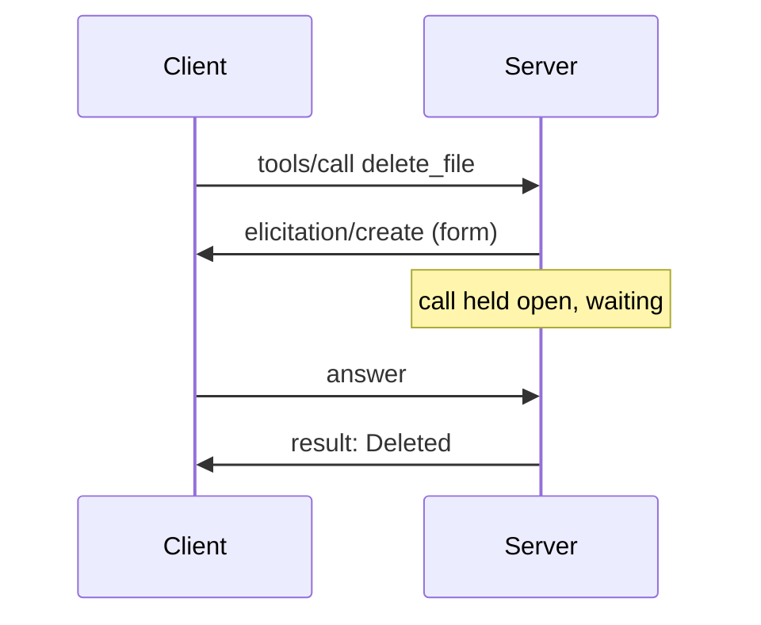
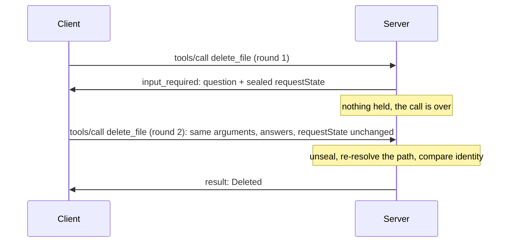

*A bridge between Part 1 of the [MCP Security]() series and what comes next.*

## The question

In Part 1, `delete_file` asked the user to confirm through [elicitation](/glossary/elicitation/) in the middle of the call. The server sent `elicitation/create`, held the [tool call](/glossary/tool-call/) open, and carried on when the answer came back. It also read the client's [roots](/glossary/roots/) to decide where it could work.

[MCP](/glossary/mcp/) 2026-07-28 removes both. Roots are deprecated, and server-initiated requests are gone: "The previous pattern of server-initiated requests is no longer supported. This is a breaking change." The reference repo has moved to 2026-07-28. Does everything Part 1 proved still hold, and what had to change for it to?

## The threat

In Part 1, everything the server needed between question and answer lived in a suspended function: the resolved path, and the file's identity at the moment it asked. Nothing outside the server could touch it.

With [multi round-trip requests](/glossary/mrtr/) (MRTR), the call ends when the server asks. What the server needs to check the answer goes out to the client as [request state](/glossary/request-state/), and comes back on a second `tools/call`, which is a new, independent request. That opens four ways to go wrong.

The client can edit what the server remembered, say the file's identity. It can send the same state and answer twice, or attach them to a call for a different file. The file can change between rounds: the [TOCTOU](/glossary/toctou/) gap from [One delete, every check](), now with no call held open at all. And the retry can carry different arguments from the ones the user approved.

## What the spec says

The [MRTR page](https://modelcontextprotocol.io/specification/2026-07-28/basic/patterns/mrtr) puts the burden on the server:

> servers **MUST** treat `requestState` as an attacker-controlled input. If `requestState` influences authorization, resource access, or business logic, servers **MUST** protect its integrity (e.g. HMAC or AEAD) and **MUST** reject state that fails verification.

To limit replay, servers **SHOULD** bind the state to the authenticated principal, a short expiry, and an identifier for the originating request. Then the important caveat:

> these measures bound the replay window and prevent cross-user and cross-request reuse, but do not by themselves guarantee single-use. Servers for which a given `requestState` must be consumed at most once (e.g., one-time redemptions) **MUST** enforce that invariant server-side.

The client's side is simple: it "**MUST** echo back the exact value" and "**MUST NOT** inspect, parse, modify, or make any assumptions about the `requestState` contents".

The [roots page](https://modelcontextprotocol.io/specification/2026-07-28/client/roots) says new implementations "**SHOULD NOT** adopt it; existing implementations **SHOULD** migrate to passing directories or files via tool parameters, resource URIs, or server configuration."

## The reference implementation

Before, one request was held open while a person thought:



After, there are two requests, and nothing is held between them:



Here is the old `delete_file`. `asked_about` is a local variable, safe in the server's memory while `confirm_deletion` waits:

```python
async def delete_file(filepath: str, ctx: Context) -> str:
    # …
    file_path = await resolve_in_roots(filepath, ctx)
    if not file_path.exists():
        raise ToolError(f"File {filepath} not found")
    asked_about = file_identity(file_path)
    confirmation = await confirm_deletion(filepath, file_path, ctx)
    # …
    file_path = await resolve_in_roots(filepath, ctx)  # again: the user may have taken minutes
    try:
        if file_identity(file_path) != asked_about:  # delete only the file the user confirmed
            raise ToolError(f"File {filepath} changed while waiting for confirmation; not deleted")
```

[Full source](https://github.com/dominicfarr/mcp-secuirty-working-notes-example/blob/7c1324c7d00fa524b1340236894cc83992f720dc/server/server.py#L265-L283)

The new one runs twice. With no answer, it asks and returns. With an answer, it reads back what it remembered from the state:

```python
def delete_file(filepath: str, ctx: Context) -> str | InputRequiredResult:
    # …
    file_path = resolve_allowed(filepath)  # every round: the retry is a new, untrusted request
    answer = (ctx.input_responses or {}).get(CONFIRM_KEY)
    if not isinstance(answer, ElicitResult) or ctx.request_state is None:
        return ask_to_confirm(filepath, file_path, ctx)  # round 1, or an answer without state
    asked = json.loads(ctx.request_state)  # sealed: unchanged since round 1, and not expired
    confirmation = confirmed(filepath, answer)
    # …
    try:
        if str(file_path) != asked["path"] or list(file_identity(file_path)) != asked["identity"]:
            raise ToolError(f"File {filepath} changed while waiting for confirmation; not deleted")
```

[Full source](https://github.com/dominicfarr/mcp-secuirty-working-notes-example/blob/096d5accedffc2c407adb3f450bf6e32d947b840/server/server.py#L265-L283)

The checks are the same, plus a comparison of the path; what moved is where the memory lives. Round 1 puts the path and identity into the state:

```python
def ask_to_confirm(filepath: str, file_path: Path, ctx: Context) -> InputRequiredResult:
    # …
    question = ElicitRequest(params=ElicitRequestFormParams(
        message=message, requested_schema=DeleteConfirmation.model_json_schema()))
    state = {"path": str(file_path), "identity": list(file_identity(file_path))}
    return InputRequiredResult(input_requests={CONFIRM_KEY: question},
                               request_state=json.dumps(state))
```

[Full source](https://github.com/dominicfarr/mcp-secuirty-working-notes-example/blob/096d5accedffc2c407adb3f450bf6e32d947b840/server/server.py#L184-L202)

That state is plain JSON, so it has to be sealed. fastmcp installs the MCP SDK's sealing boundary; the server sets its lifetime where it is built:

```python
class ModernProtocolOnly(Middleware):
    """Refuse handshake-era clients. Only they send initialize, and this server's confirmations
    use multi round-trip requests, which exist only on MCP 2026-07-28."""

    async def on_initialize(self, context, call_next):  # pylint: disable=unused-argument
        raise ToolError("this server speaks MCP 2026-07-28 only")


# requestState is sealed (encrypted, integrity-checked, bound to the request, expiring) because it
# passes through the client: the spec requires servers to treat it as attacker-controlled.
mcp = FastMCP("Permission-Based MCP Server",
              request_state_security=RequestStateSecurity.ephemeral(ttl=CONFIRMATION_TTL_SECONDS),
              middleware=[ModernProtocolOnly()])
```

[Full source](https://github.com/dominicfarr/mcp-secuirty-working-notes-example/blob/096d5accedffc2c407adb3f450bf6e32d947b840/server/server.py#L50-L62)

`RequestStateSecurity.ephemeral` encrypts and authenticates the state (AES-GCM, under a key that lives only as long as the server process), binds it to the tool and the arguments it was minted for, and expires it after 120 seconds. A changed byte, another file's call, or a late answer all get "Invalid or expired requestState", and nothing is deleted. The spec's principal binding has nothing to bind to here: a local stdio server has no authenticated user.

On the [client](/glossary/mcp-client/) side, the round loop re-sends the stored request the user approved, adding only the answers and the echoed state:

```python
    async def _call_server(self, request: ToolRequest, call: CallInProgress):
        # …
        answers, state = None, None
        async with self._server_call() as session:
            for _ in range(INPUT_ROUNDS_MAX):
                result = await session.call_tool(request.tool_name, arguments=request.arguments,
                                                 input_responses=answers, request_state=state,
                                                 allow_input_required=True)
                if not isinstance(result, InputRequiredResult):
                    return result
                call.rounds.append(result.request_state or "")
                answers = await self._answer_input_requests(result.input_requests or {})
                state = result.request_state  # echoed exactly; None stays None
        raise MCPError(INVALID_REQUEST,
                       f"the server still needed input after {INPUT_ROUNDS_MAX} rounds")
```

[Full source](https://github.com/dominicfarr/mcp-secuirty-working-notes-example/blob/096d5accedffc2c407adb3f450bf6e32d947b840/client/client.py#L370-L386)

Roots became a folder the client passes when it launches the server (`--allowed-folder`). The overlap rule is the one [the roots post]() described; what changed is where the folder comes from:

```python
def resolve_allowed(filepath: str) -> Path:
    """resolve_in_workspace, then require the path to be inside the allowed folder."""
    file_path = resolve_in_workspace(filepath)
    area = allowed_area()
    if area is None or not file_path.is_relative_to(area):
        raise ToolError(f"Access denied: {filepath} is outside the allowed folder")
```

[Full source](https://github.com/dominicfarr/mcp-secuirty-working-notes-example/blob/096d5accedffc2c407adb3f450bf6e32d947b840/server/server.py#L130-L135)

It is still advisory in the same way roots were: only the [server's](/glossary/mcp-server/) own code enforces it.

## Gotchas

**One code path can't serve both eras.** fastmcp rejects `InputRequiredResult` on a handshake-era connection, and on 2026-07-28 there is no mid-call request for `ctx.elicit` to send. So the server picks 2026-07-28 and refuses `initialize` outright. An old client gets a clear error, not a confirmation that never arrives.

**The seal is not single-use.** For 120 seconds, the same state and answer can be sent again. That's exactly the gap the spec warns about. Here the identity check narrows it: after the first delete, the file is gone, or whatever sits at that path has a different inode, size or modification time, so the retry is refused. Only the very same file, put back unchanged within those 120 seconds (say, a backup renamed back), could be deleted again.

**Drive the rounds yourself.** The MCP client library can answer and retry on its own. Doing it in the app puts the rule "retry with the approved arguments" in code a test can pin, and shows each round in the timeline.

**A restart orphans open questions.** Changing the folder restarts the server, and a question the old server asked can't be answered into the new one. The client closes it and audits that. The final review caught this; the first version left the question open.

**Timeouts become expiry.** Nothing on the server waits any more. The old 120-second server wait is now the state's lifetime, and the client stops waiting for the user a few seconds after it.

**No handshake, no `serverInfo` up front.** fastmcp sends none on 2026-07-28, so the client falls back to the server's script name.

## Proof

All at the migration commit, `096d5ac`:

- Sealed state: [tampered](https://github.com/dominicfarr/mcp-secuirty-working-notes-example/blob/096d5accedffc2c407adb3f450bf6e32d947b840/tests/test_request_state.py#L30), [reused for another file](https://github.com/dominicfarr/mcp-secuirty-working-notes-example/blob/096d5accedffc2c407adb3f450bf6e32d947b840/tests/test_request_state.py#L45), [answer without state](https://github.com/dominicfarr/mcp-secuirty-working-notes-example/blob/096d5accedffc2c407adb3f450bf6e32d947b840/tests/test_request_state.py#L60). The first two include a control: the untouched state on the right call is accepted.
- Between rounds: [`test_file_changed_between_rounds_is_not_deleted`](https://github.com/dominicfarr/mcp-secuirty-working-notes-example/blob/096d5accedffc2c407adb3f450bf6e32d947b840/tests/test_elicitation.py#L203), [`test_file_removed_between_rounds_is_reported`](https://github.com/dominicfarr/mcp-secuirty-working-notes-example/blob/096d5accedffc2c407adb3f450bf6e32d947b840/tests/test_elicitation.py#L134), [`test_symlink_swapped_between_rounds_is_not_followed`](https://github.com/dominicfarr/mcp-secuirty-working-notes-example/blob/096d5accedffc2c407adb3f450bf6e32d947b840/tests/test_workspace.py#L44).
- Expiry: [`test_expired_confirmation_deletes_nothing`](https://github.com/dominicfarr/mcp-secuirty-working-notes-example/blob/096d5accedffc2c407adb3f450bf6e32d947b840/tests/test_elicitation.py#L122).
- Approval: [`test_retry_sends_the_approved_arguments`](https://github.com/dominicfarr/mcp-secuirty-working-notes-example/blob/096d5accedffc2c407adb3f450bf6e32d947b840/tests/test_approval.py#L51).
- Protocol: [`test_client_speaks_2026_07_28`](https://github.com/dominicfarr/mcp-secuirty-working-notes-example/blob/096d5accedffc2c407adb3f450bf6e32d947b840/tests/test_connection.py#L59), [`test_handshake_client_is_refused`](https://github.com/dominicfarr/mcp-secuirty-working-notes-example/blob/096d5accedffc2c407adb3f450bf6e32d947b840/tests/test_connection.py#L67).
- Folder: [`tests/test_folder.py`](https://github.com/dominicfarr/mcp-secuirty-working-notes-example/blob/096d5accedffc2c407adb3f450bf6e32d947b840/tests/test_folder.py), including `test_folder_change_closes_an_open_question`.

The Part 1 posts still link to `03a9398`, where their code lives unchanged.

## Moving your own server

- Choose one era per server, or write and test two asking paths. Asking works differently in each; this repo chose one.
- Turn each `await ctx.elicit(...)` into a returned `InputRequiredResult`, plus a branch for the round that brings the answer.
- Put whatever the answer must be checked against into `requestState`, sealed, with an expiry in place of the old wait timeout.
- Re-check everything on the retry: path, permissions, the file's identity. It's a new request.
- Make destructive retries harmless to repeat. The seal doesn't stop replay.
- Replace roots with launch configuration.
- In the client, retry with the arguments the user approved, never ones rebuilt from the model or the UI.

---

[Series hub]() · [Roots are a request, not a wall]() · [Ask the human, not the caller]() · [One delete, every check]()
