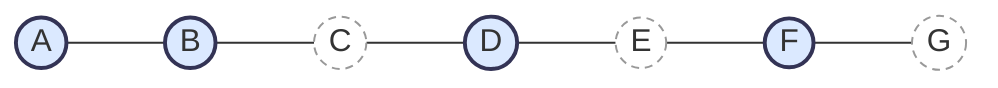

Part 1 of [How I Hire](). Planning: what to do before a single job ad goes out.



## The story: we started too late

At Policy Expert our first rounds of hiring started too late. We had growth needs in the software and in the team at the same time, and we couldn't find good people quickly enough. Every CV, call and interview came out of the same small team that was supposed to be delivering. We reckoned hiring was taking 20–30% of our time. In a small team, the whole organisation feels that. Delivery slowed down noticeably because of the context switching.

So we took the higher cost of contractors over slowing down any further. That decision is where the way I plan now comes from.

## Plan three to six months out

Hiring is slow. Sourcing takes time, vetting takes time, good people have notice periods, and onboarding takes longer than anyone budgets for. Add it up and a hire you need today is a hire you should have started a quarter ago.

So I plan three to six months out, and I treat the gap between now and then as its own problem.

## Contractors first, blended with permanent hires

If the need is real now, I bridge it with a strong contractor, with clear objectives bounded to that three-to-six-month window. The bounds matter. Without them a contractor drifts into long-term work and you've built a dependency instead of a bridge. With them, the contractor gets today's work done and gets the ground ready, so the permanent hires walk into something they can pick up.

It costs more per day. It costs a lot less than a team losing 20–30% of its time to hiring while the roadmap waits.

## Write the rubric before you source

Before a job ad goes out, I write the rubric: the competencies every candidate is scored against, and what "meets" looks like at this level. Everything after it is built from it, the job description and the CV screen included. [Vet]() has the full version.

## Culture add, as a piano scale

I don't hire more of the same. I hire for culture add, and the way I explain it is a piano scale.

Say the team covers the notes A, B, D and F. Another A doesn't make the music any richer. What I'm looking for is C, E or G: notes that complement the team, inside the same cultural octave. They share the values. They bring something the team doesn't have yet.

_Filled: notes the team already has. Dashed: the gaps worth hiring for._

Skills work the same way. Nobody knows all of Python. A team where everyone is strong in the same corner of it has blind spots in the same places. I'd rather hire depth that complements what's already there.

## Take it with you

**Work back from the start date.** A rough guide; adjust it for your market and the level of the role.

| Stage                              | Rough time | What stretches it                          |
| ---------------------------------- | ---------- | ------------------------------------------ |
| Source and screen                  | 3–6 weeks  | Senior or niche roles                      |
| Vet: take-home, face to face, vote | 1–3 weeks  | Panel availability                         |
| Offer and notice period            | 4–12 weeks | Notice periods of one to three months      |
| Onboard to useful                  | 4–12 weeks | No onboarding document, no first-week task |

Add the rows up and you're at three months on a good run and six on a slow one. That's the window the contractor covers.

**Contractor bridge brief**

- [ ] A written objective: what is done when the contract ends.
- [ ] An end date agreed up front, inside the three-to-six-month window.
- [ ] Handover built in: tests, docs and notes the permanent hires can pick up.
- [ ] Nothing that outlives them owned only by them.

Next: [Source](), finding and attracting the people the rubric describes.
