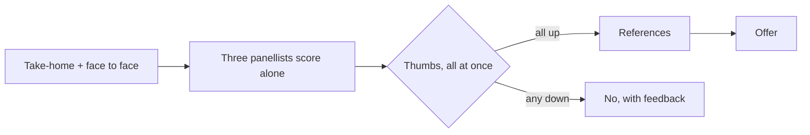

Part 3 of [How I Hire](). Vetting: hire engineers, not coders.



At Informa I asked candidates to list the Hibernate API and define each method. That tells you who has a good memory. It doesn't tell you who can build software with other people, keep it working, and change it next month. Vetting is about the second thing.

## The home test

We tried FizzBuzz first. It stopped being useful quickly, because people came prepared. So we moved to a kata: the shopping cart.

Everyone knows a shopping cart. Add and remove items, calculate a price, apply a discount and tax. Nobody needs domain knowledge to start. But the design can go many ways, and everyone takes it slightly differently, which is the point.

I keep the test short. A long test pushes good candidates away, because good candidates are busy. And very little of the signal is in the test itself. It's what follows that tells you something. The test just needs to make it easy to show what matters: tests first, SOLID, clean code, ports and adapters, CI, small commits with good messages, and how they used AI, if they did.

## Review and extension, face to face

This is where the best signal is. First I ask about the test: how they approached it, why they included what they did, and what they left out.

Then I give them a new requirement, and we pair on it. A new discount rule, say. This is the most realistic part of the whole process. Software evolves, new features arrive, and this shows how someone extends code they wrote under time pressure. It's also what most weeks in the job actually looked like: evolving a solution a step at a time.

It's the strongest defence I know against code someone didn't write. You can't extend a design you don't understand.

## Principles over frameworks

Frameworks can be learned in weeks. Habits take years. So I ask less "do you know Spring?" and more "why does dependency injection help testing?", "have you paired before?", "what have you read recently?" I'm listening for test-driven work, immutability, sensible DRY, YAGNI, robustness and refactoring.

## The rubric

At Policy Expert the rubric was pass/fail per competency. That was enough to score strictly, but not to tell a junior who's ready from a senior who isn't. Today's version uses four competencies, scored 1 to 4, with "meets" described differently at each level.

| Competency                     | Junior meets                                                | Mid meets                                                               | Senior meets                                                           |
| ------------------------------ | ----------------------------------------------------------- | ----------------------------------------------------------------------- | ---------------------------------------------------------------------- |
| Problem-solving & code quality | Working, readable code; finds the constraints with guidance | Clarifies the problem, decomposes it, handles the edge cases they found | Finds hidden constraints unprompted; clean, testable; names trade-offs |
| Technical judgment             | With guidance, explains a choice and the alternative        | Explains choices, names an alternative and a failure mode               | Ties decisions to scale, maintainability and team skill                |
| Communication & collaboration  | Talks through their thinking when prompted; uses feedback   | Explains clearly while working; self-documenting code                   | Structures it for the audience; code a new teammate can pick up        |
| Curiosity & growth             | Has taught themselves something and used it                 | Has learned outside their lane and applied it                           | Has improved things beyond their role; mentored others                 |

The full rubric, with all four scores at all three levels, is a [download](/assets/how-i-hire/hiring-rubric.md).

Three open questions about their history go with it, and each one is scored against a row, so the answer is scored, not felt:

- **Something you're proud of** → curiosity & growth.
- **Something that didn't go to plan** → technical judgment.
- **How you handle disagreement** → communication & collaboration.

This isn't just my preference. The selection research has said for a long time that structured interviews, scored against a consistent rubric, predict job performance better than unstructured ones. A 2022 re-analysis by Sackett and colleagues still ranked them first ([SIOP summary](https://www.siop.org/tip-article/is-cognitive-ability-the-best-predictor-of-job-performance)).

## AI is the new IDE

I assess the software engineering, not the editor. Not using AI is scored neutrally, the same way I'd treat someone who works in vim: respect, though most people use an IDE for good reasons.

I'll be honest: I don't fully know the answer here yet. What I look for is discipline. Small commits, tests first, refactoring to cut the bloat, stopping the architecture drifting, keeping the tools consistent. I assess the principle, controlled and repeatable work, not the tool, and I don't mark anyone down for a free tier or no AI at all. If a role genuinely needs AI fluency, it goes in the rubric explicitly.

The policy goes in the test brief, and I ask for the trail: the commit history and a short note on what they delegated and what they rejected. The extension session does the rest.

Companies are landing in different places. [Canva now expects](https://canva.dev/blog/engineering/yes-you-can-use-ai-in-our-interviews) engineering candidates to use AI tools in technical interviews. Meta has [reportedly been trialling](https://www.techradar.com/pro/meta-is-going-to-let-candidates-use-ai-in-job-interviews) AI-assisted coding interviews. Amazon [reportedly tells candidates](https://www.itpro.com/business/careers-and-training/amazon-bans-ai-tools-during-job-interviews) not to use generative AI unless it's explicitly permitted.

On my side of the table, AI can summarise interview notes, with the candidate's consent. It never scores and never rejects anyone. The EU AI Act [classes AI used to evaluate candidates as high-risk](https://eur-lex.europa.eu/eli/reg/2024/1689/oj), and New York City [requires bias audits](https://www.osc.ny.gov/state-agencies/audits/2025/12/02/enforcement-local-law-144-automated-employment-decision-tools) of automated hiring tools. That's the right instinct.

## The decision

The panel is three people. Each one scores the take-home and the face-to-face session against the rubric on their own, before anyone talks. Then we vote, colosseum style: everyone shows a thumb at the same moment. One thumb down is a no, and that includes mine.

Scoring alone first matters. In my experience, once someone senior has spoken, everyone else's view drifts towards theirs. Voting at the same moment does the same job at the end. Most panels don't require unanimity. Mine does.

## The story: the override

The unanimous vote has a story behind it.

Early on, while we were still building the process, I overrode the panel. The candidate was switching from PHP to Java, and I believed in them. They had the principles. But they didn't ramp up in time, even after we extended their probation.

That's why the vote is unanimous now. Nobody is outvoted, so nobody gets to say "I told you so" later, and the whole panel owns the hire. The lesson wasn't "don't hire people switching stacks". It was: decide together, and when someone is switching stacks, write the ramp-up into the probation plan with milestones from day one. [Onboard]() has the plan.

## References

References come after the panel decides and before the offer. They confirm; they don't decide. I ask a former manager specific questions mapped to the rubric rows, not "would you hire them again?"

## What I'd do differently today

- The levelled rubric, not pass/fail.
- Every question mapped to a rubric row.
- Ramp-up milestones written in for anyone switching stacks.
- An AI policy stated in the brief.

Next: [Onboard](), from yes to settled in.
