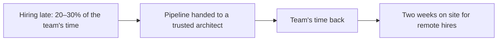

Part 4 of [How I Hire](). Onboarding: from the decision to someone settled in the team.



## When it's a no

Hiring is a human activity. When someone doesn't get the job, I give them useful feedback, centred on the gap, not on the person. It helps them succeed next time instead of going over unanswered questions in their head. They put real work into the process, and that deserves a real answer.

## The offer

I have some flex, and firm boundaries. Salaries get compared, sooner or later. Pay far out of line with the rest of the team, too high or too low, turns into a cultural problem the moment it does.

## The first week

Three things make the first week work.

**An onboarding document.** It covers the company, the team, the product, the system and its architecture, and the team's standards and expectations. The new hire owns it. Whenever they find something out of date or missing, they fix it, for the next person. It gets them up to speed quickly, and it's never stale for long, because the person who most needs it is the one who keeps it current.

**A small, useful task, shipped in week one.** Something real for the team or the product. They get an early win, and the team gets value from them straight away.

**Introductions.** To the team, and to the wider company where I can, saying what they'll be doing and the difference they'll make. I take them to lunch on day one to hear their first impressions. At the end of the first week there's a team lunch. No work talk, just social.

## Probation

Probation is three to six months, depending on the role. It can end early, and it can be extended.

There's a plan, written down and explicit, and we use it in our regular 1:1s. The team knows the plan too, and I meet with them to understand how the new person is getting on against it. If they're not hitting the mark, we adjust. I do what I can to make it work. Hiring is costly, and success is the goal for everyone.

When someone is switching stacks, the ramp-up goes into the plan with milestones from day one. That's the lesson from the override in [Vet]().

## The story: two weeks on site

At Policy Expert many of our hires were remote, offshore or outside London. Their first two weeks were on site in London, embedded in the core teams. Then they went home.

It was only possible because the existing team had its time back. Once the pipeline moved to a trusted architect (the story in [Source]()), the team could spend its time on the platform and on onboarding people properly, instead of interviewing.

When I spoke with the teams afterwards, the remote developers who'd been on site felt connected to the product and the people, onboarding had gone more smoothly, and satisfaction was higher. That's what the teams told me, not something we measured, but it was consistent.

## Take it with you

**Onboarding document outline**

1. The company: why it exists, how it makes money, who the customers are.
2. The team: who's who, how we work, our rituals.
3. The product: what it does, for whom, what's changing.
4. The system: architecture, how to run it, how to deploy it.
5. Standards and expectations: testing, code review, commits, on-call.
6. Owner: the newest hire. Fix anything wrong for the next person.

**Probation plan**

|          | Month 1                             | Months 2–3                     | Months 4–6 (if used)                    |
| -------- | ----------------------------------- | ------------------------------ | --------------------------------------- |
| Goal     | Shipped something; knows the system | Owns small features end to end | Owns medium-sized work with real impact |
| Evidence | Week-one task, first PRs            | Features shipped, code review  | Delivery, team feedback                 |
| Check-in | Weekly 1:1, against this plan       | Weekly 1:1, team check         | Decision: confirm, extend or end        |

Add a ramp-up row with milestones for anyone switching stacks.

Next: [Reflect](), what each hire teaches you about the next one.
