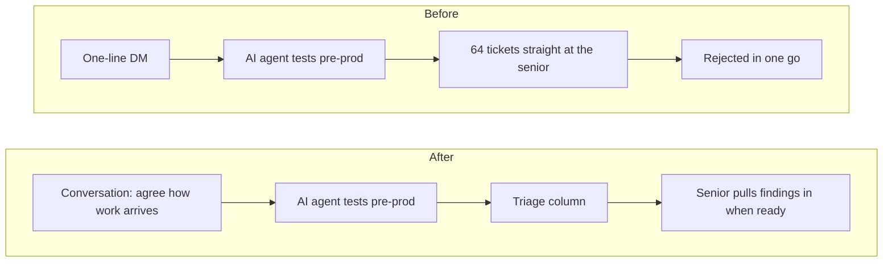
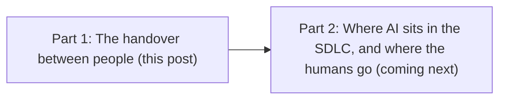

A senior front-end developer sent a one-line direct message to a junior colleague: could they test the latest release candidate?

Within two days, 64 tickets landed in Jira. Each one came with steps to reproduce, a note on the risk, the blast radius (how much of the system a failure would touch), and a branch and pull request containing a fix. A second AI agent had checked every finding before it was raised. Very little was left for the receiver to do beyond review and merge.

All 64 were rejected in one go, without comment.

I sampled them afterwards. Among them was an endpoint that anyone could write to without logging in, with nothing in front of it to stop them. That one would have been serious if the wrong person had found it first. The AI was right, and it still made things worse.

## How it got there

This was a startup I worked with. The junior engineer had DevOps in their title and leaned heavily on AI tools. The senior front-end developer had little automated testing of their own and was under real pressure to deliver. Much of the business-level testing happened after deployment to pre-prod.

So the junior pointed an AI agent at the pre-prod build. They asked it to try specific actions and to hunt for edge cases and security holes. It was fairly good at smashing the application.

The senior was candid about why the tickets went back. They didn't trust how the junior used AI, so they didn't trust the pull requests. And 64 of them had arrived at once, on top of a delivery deadline.

The two of them had basically stopped talking to each other in a meaningful way. What contact they had shrank to short Slack messages. The junior felt their work had been disregarded, as if it had no value. The senior had a stack of someone else's priorities on top of their own.

My sympathy was with the junior in this case. They were doing useful work in a modern way, with little or no definition from the requesting party, finding holes that an attacker's AI tools would find anyway. But the senior was under pressure too, and nobody had agreed how that work should arrive. Neither of them was the villain. Both were casualties of a dysfunctional culture and poor ways of communicating.

## A one-line request got a 64-ticket reply

The request was a single line, and the reply was 64 tickets. Neither of them said what they needed before the work started, and that gap is where it went wrong.

AI produces volume, and volume without an agreement overwhelms people. Sixty-four tickets in two days means someone else's priorities landing on you all at once and late in the process. Each ticket was careful. Taken together, they were too much to absorb.

There's a trust problem underneath, too. My view is that AI output inherits the trust people have in whoever sends it. In a team where trust is already low, doubt about the AI attaches to the person using it, and doubt about the person attaches to the AI. The senior's own words show both at once. They aren't unusual. In [Stack Overflow's 2025 survey](https://survey.stackoverflow.co/2025/ai), 46% of developers distrust the accuracy of AI tools against 33% who trust it, and only 3% trust it highly. [Sonar's January 2026 survey](https://www.sonarsource.com/company/press-releases/sonar-data-reveals-critical-verification-gap-in-ai-coding/) found that 96% don't fully trust AI-generated code to be functionally correct, and 61% say it often looks correct when it isn't. If people doubt AI-written code, they'll doubt AI-written bug reports too.

A fair reader might say the junior should have triaged first and sent the five worst, and that rejecting unreviewed AI fixes was the prudent call. The first part is fair. Whoever sends the findings owns what they choose to send. On the second, I'd say sample a handful, as I did, and see for yourself. My sample showed the findings had real value.

The [2025 DORA report](https://cloud.google.com/blog/products/ai-machine-learning/announcing-the-2025-dora-report) calls AI "the great amplifier". Teams with fast feedback and loosely coupled systems, where parts can change independently, see gains. Elsewhere, AI adoption goes hand in hand with less stable delivery. I've written before that [delivery processes are trust mechanisms](/2026/02/25/the-processes-we-follow-for-delivering-create-soft.html), and this team showed it. Its low trust was amplified the moment the AI arrived.

## Agree the handover, then let the receiver shape triage

I heard each of them out separately, because they wouldn't talk together, and I didn't dismiss either of them. I sample-checked the bugs to show they had value. I also helped the junior see what more than 60 tickets feels like to someone already under pressure to deliver.

Then I told the junior that a concise request is still an invitation to build a shared mental model, a common picture of what those few words actually meant. They were, after all, engineers. Clarify the open questions, and agree how the work will arrive before starting the task.

The junior went and spoke to the senior directly. It was one of the first times in a long while that the two of them had talked and agreed a plan together. What they agreed was a new triage column on the front-end board: a holding area where the AI's findings land, and from which the senior pulls them into the workload when they can. This was a big improvement in the way they approached working together.

The principle is that triage belongs to the people who own the work. The sender decides what to send, and the receiver decides when and how to take it in.

I added one more thing for the junior. Good [platform engineering](/2026/10/28/devops-was-never-supposed-to-be-a-role.html) starts with knowing your customer, in this case the front-end and back-end developers. Find out what bothers them most about their job, and solve it with the platform if you can. Then bring your own priorities to them, so they can help shape them.

## Start with the handover

The junior's work mattered. In November 2025, Anthropic described [disrupting an espionage campaign](https://www.anthropic.com/news/disrupting-AI-espionage) in which AI did 80–90% of the work, making thousands of requests, often several per second. If your AI doesn't find an open endpoint, someone else's eventually will. As agents produce more, the bottleneck moves to the person who receives their output, so the handover is where your effort pays off.

Whichever side you're on, here are two questions to take into your week. If you're handing AI output to someone, have you asked them what would make it easier for them to take? And if you're the one asking for help, does your one-line request say what you need back?

This is the first of two posts. The next looks at where AI sits across the software development lifecycle, and where the humans go. [Where AI sits in your SDLC, and where the humans go](/2026/11/06/ai-in-the-sdlc.html)
