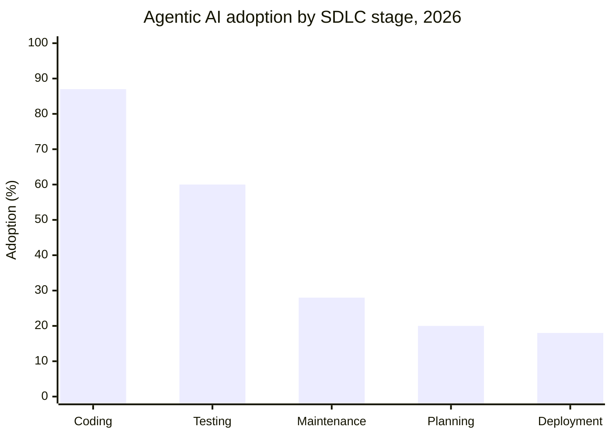
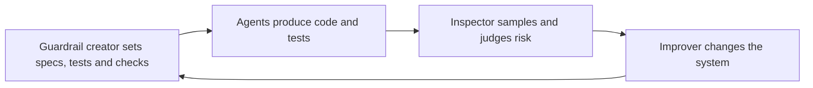
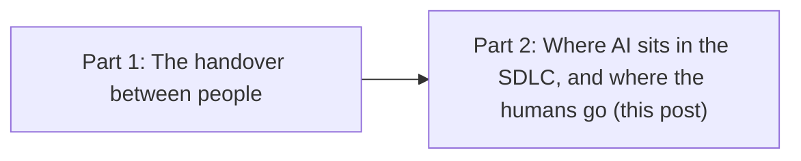

AI already writes a big share of the code that gets committed. Sonar's developer survey in January 2026 put it at about 42%, and developers expected that to reach 65% by 2027. If you're in your first few years as an engineer, that number can feel personal. If writing code stops being the scarce skill, it's fair to wonder what the scarce skill becomes.

My last post was about one handover between two people, where an AI found real problems and still made things worse. This one zooms out to the whole software development lifecycle (the SDLC: plan, design, code, test, deploy, operate) and looks at where the human work goes.

## AI goes where checking is cheap

AI adoption is very uneven across the lifecycle. Coding is close to saturated, and Infotech's June 2026 study found that 84% of developers use AI to build. The other stages trail a long way behind.

*Midpoints of compiled estimates from Keyhole Software, which draws on several surveys; individual surveys vary. Coding sits at the easy-to-check end, and deployment at the expensive-to-get-wrong end.*

Keyhole offers an explanation I find convincing. Adoption is highest where AI output is easy to check line by line, and lowest where a mistake is expensive to catch after the fact. A wrong function shows up in review or in a failing test. A wrong deployment shows up in production. Another explanation fits too, because coding tools simply arrived first. Either way, AI now produces more than people can comfortably check, and verification becomes the bottleneck.

DORA's 2025 research backs this up. AI raised teams' throughput, but it hurt stability unless they had strong automated testing, mature version control and fast feedback. Two-thirds of Infotech's respondents said AI code needs more testing than human code. I wrote about redesigning delivery for this in [Your Delivery System Was Designed for a Different Constraint](/2026/02/24/assume-code-becomes-semi-black-box-redesign-delive.html), so I won't repeat it here.

## Three roles for the humans

This is how I think about it. As AI does more of the producing, people move to the work that makes its output trustworthy. I see three roles in that work, and most engineers will do some of each.

**Guardrail creator.** Guardrails are what the agents work inside. They include specs with clear acceptance criteria (the conditions a feature must meet to count as done), tests, API contracts, policies and the pipeline checks that enforce them. The key habit is writing tests from the spec, before any code exists. When the same AI writes the code and its tests, the tests can end up checking that the code agrees with itself. That's called circular validation, and it's the AI marking its own homework. This work often sits with platform engineering, the team that builds the tools and paths other developers use. Futurum argued in December 2025 that platform teams now need to host, orchestrate and govern agents, and it found that nearly half of platform engineering groups already use AI tools.

**Inspector.** Inspectors sample AI output, validate it, and judge its risk and blast radius (how much of the system a failure would touch). In my last post, I sampled 64 AI-raised tickets to see whether they had value, and one turned out to be a serious security hole. Sonar found that only 48% of developers always check AI code before they commit it, so there's plenty of room in this role.

**Improver.** When an inspector finds a problem, the improver fixes the system that produced it. They tune the spec, the prompts, the agent's setup or the pipeline, so the same mistake doesn't come back.

The roles feed each other. The junior engineer in my last post was effectively an inspector, pointing an AI agent at a release candidate and raising what it found. As I saw it, my coaching moved them toward guardrail creator, building the platform around what the developers they supported needed.

## When it applies, and the worry about the bottom rung

This applies wherever AI produces a large share of the output, whether that's code, tests, tickets or infrastructure. Humans stay the authors where judgement is the work. Resolving ambiguous requirements, owning what the business intends, and approving scope and architecture trade-offs all stay with people.

These roles can sound senior, and that leads to a fair worry. If AI takes the junior coding work, it's reasonable to ask where juniors learn enough to inspect anything, and whether the bottom rung of the ladder has gone.

I think checking AI output is now one of the best ways to learn. Picture a junior joining a team where an agent writes most of the API code. Their first job is to turn each ticket's acceptance criteria into tests before the agent starts. To write those tests, they have to understand what the business actually asked for. When the agent's code fails one, they have to read the code closely enough to tell whether the code or the test is wrong. The team gets tests that come from the spec, and the junior learns the code from the inside.

Coding skill still matters in all of this. You can't inspect or guard what you don't understand, so the time you spend learning to read and write code well pays off in every one of these roles.

## Where do you fit?

Two questions to take into your week:

- Which of the three roles do you already do some of, even informally?
- Where in your team's lifecycle does AI output go in without anyone checking it?

If you can answer the first one, you've already started.

This is the second of two posts. The first post, [The AI was right, and it still made things worse](/2026/11/05/the-ai-was-right-and-it-still-made-things-worse.html), looks at the handover between people.
